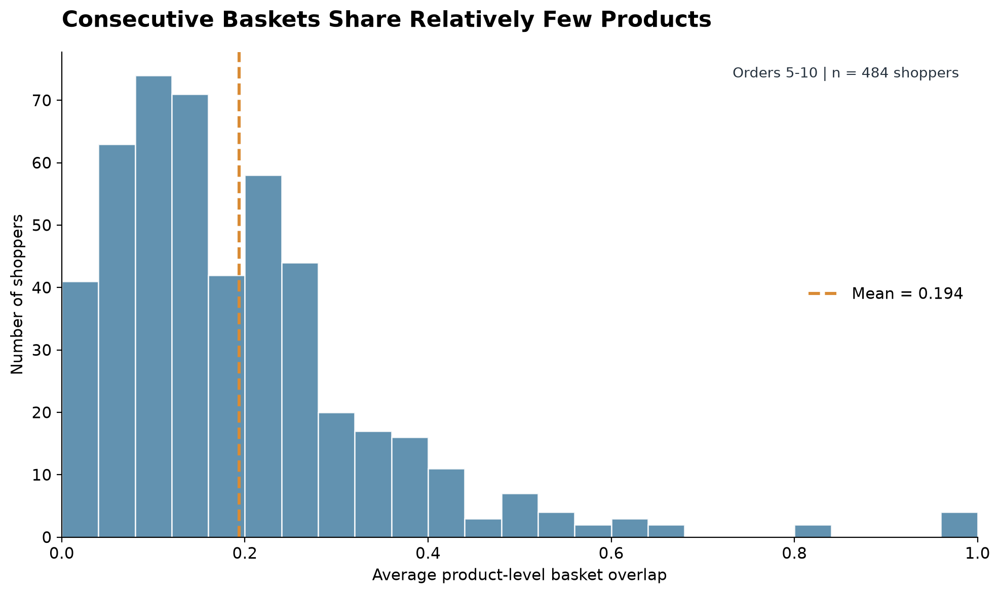
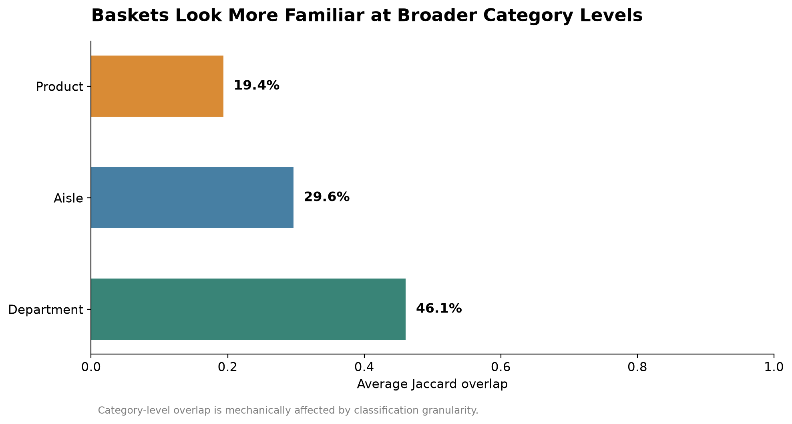
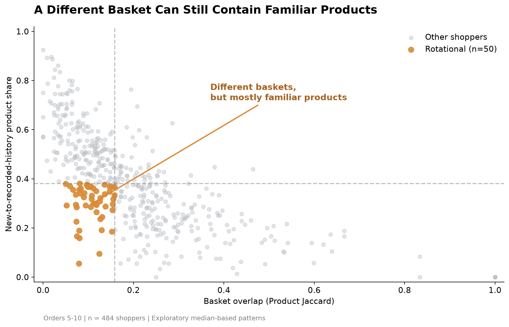
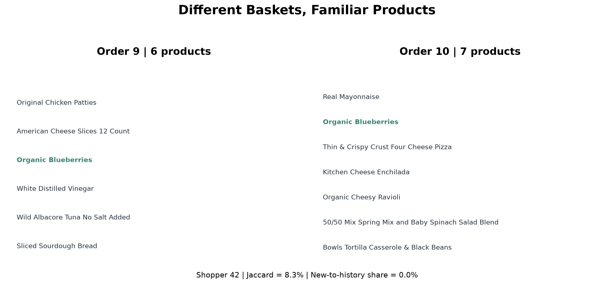
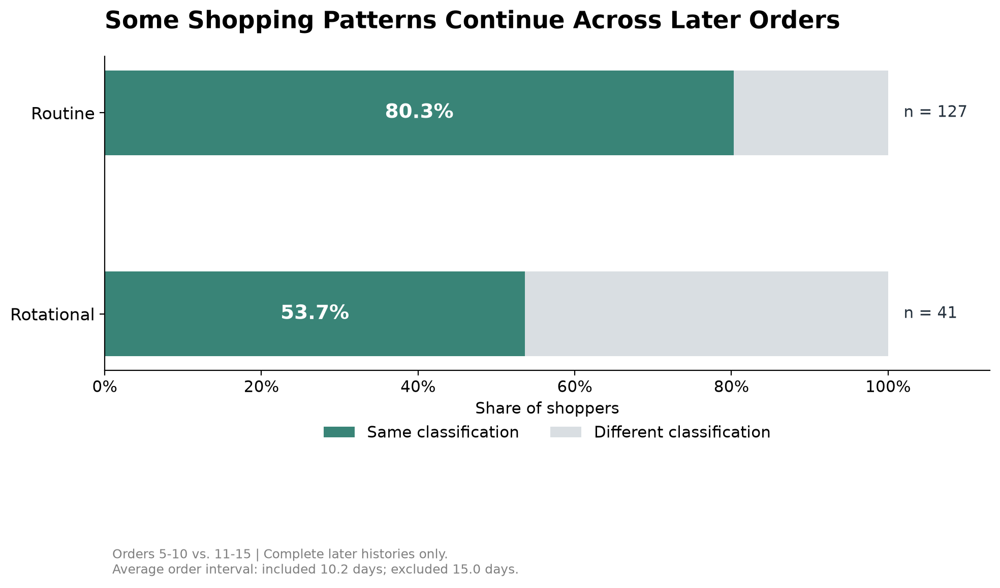

# The Habitual Shopper

> **Online grocery shopping may offer endless choices, but are you really discovering anything new?**

A reproducible analysis of the difference between changing a shopping basket and discovering products that are new to a shopper's recorded history.

**Course pages:** [Part I: Initial Proposal](https://hanklin999.github.io/tswd-portfolio/final-project-part-one) | [Part II: Development and Iteration](https://hanklin999.github.io/tswd-portfolio/final-project-part-two)

**Data source:** [Instacart Market Basket Analysis](https://www.kaggle.com/competitions/instacart-market-basket-analysis/data)

---

## Project Question

Consecutive shopping baskets can contain different products, but those products may still be familiar from earlier purchases. This project compares:

- **Basket similarity:** How much two consecutive orders overlap.
- **Category similarity:** How much their aisles and departments overlap.
- **Product novelty:** How many products are new to the shopper's recorded history.
- **Persistence:** Whether the same behavioral patterns appear in later orders.

The central claim is simple:

> **A changing basket is not necessarily a discovery basket.**

---

## Main Findings

The main analysis uses **484 shoppers** with complete records for orders 5-10.

### 1. Consecutive Baskets Share Relatively Few Products

Average product-level Jaccard similarity is **19.4%**.

### 2. Baskets Look More Familiar at Broader Levels

Average overlap increases from **19.4% for products** to **29.6% for aisles** and **46.1% for departments**. Broader categories naturally create more opportunities for overlap, so these values should not be interpreted as direct evidence of loyalty.

### 3. Basket Change and Product Discovery Are Different

Using exploratory median thresholds, **50 of 484 shoppers (10.3%)** have both relatively low basket overlap and low product novelty. The project calls this descriptive pattern **Rotational**.

Shopper 42 makes the distinction concrete. Orders 9 and 10 have only **8.3% overlap**, but every product in Order 10 appeared earlier in the shopper's recorded history.

### 4. Some Patterns Continue

Among 323 shoppers with complete later records, **80.3%** of initially Routine shoppers and **53.7%** of initially Rotational shoppers retain those classifications in orders 11-15. These percentages describe a selected validation subset, not all Instacart shoppers.

---

## Data and Measures

The analysis begins with the first 1,000 eligible users by user ID. It uses:

- orders.csv
- order_products__prior.csv
- products.csv
- aisles.csv
- departments.csv

Raw data is not included in this repository because of file size and licensing considerations. Download instructions are in [data/README.md](data/README.md).

**Jaccard similarity** is the number of shared unique items divided by the total number of unique items across two baskets. It is calculated separately for products, aisles, and departments.

**Product novelty** is the share of products with reordered = 0. In this dataset, that means new to the shopper's recorded Instacart history, not necessarily new to the shopper's life.

---

## Repository Structure

~~~text
the-habitual-shopper/
|-- analysis/
|   |-- 01_prepare_data.py
|   `-- 02_analyze_story.py
|-- data/
|   `-- README.md
|-- outputs/
|   |-- figures/
|   `-- tables/
|-- .gitignore
|-- README.md
`-- requirements.txt
~~~

- **01_prepare_data.py** selects the sample, joins product metadata, and creates consecutive basket pairs.
- **02_analyze_story.py** calculates story metrics, validation checks, tables, and figures.
- **outputs/figures/** contains the five visualization sketches used in the course pages.
- **outputs/tables/** contains claim checks, segment summaries, and robustness results.

---

## Reproduce the Analysis

1. Clone the repository and create a Python environment.
2. Install the required packages:

~~~powershell
py -m pip install -r requirements.txt
~~~

3. Download the Instacart files and place them in **data/raw/**.
4. Run:

~~~powershell
py analysis/01_prepare_data.py
py analysis/02_analyze_story.py
~~~

The first script creates processed transaction files. The second regenerates the tables and figures in **outputs/**.

---

## Limitations

- The first 1,000 eligible users are selected by user ID rather than randomly.
- Purchase records do not show browsing, searches, recommendation exposure, or motivation.
- Novelty tends to decline as more purchase history becomes available.
- Jaccard similarity is affected by basket size.
- The four behavioral classifications use sample medians and are descriptive, not validated customer segments.
- The results are observational and do not show that a recommendation strategy causes better outcomes.

---

## Practical Takeaway

For shoppers: **automate the routine and make discovery intentional.** Saved lists or subscriptions may reduce time spent rebuilding familiar orders, while deliberate comparison across products, stores, or platforms can support exploration.

For product teams: measure replenishment and discovery separately. Basket overlap alone is not enough to determine whether a shopper is exploring.

---

## Reference

Instacart. (2017). *Instacart Market Basket Analysis*. Kaggle. https://www.kaggle.com/competitions/instacart-market-basket-analysis/data
