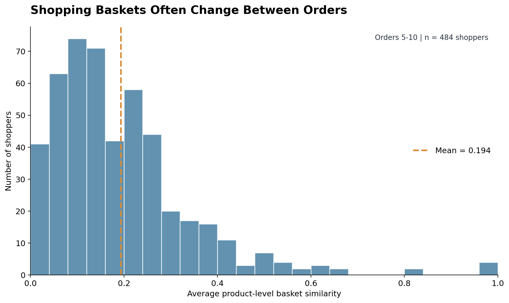
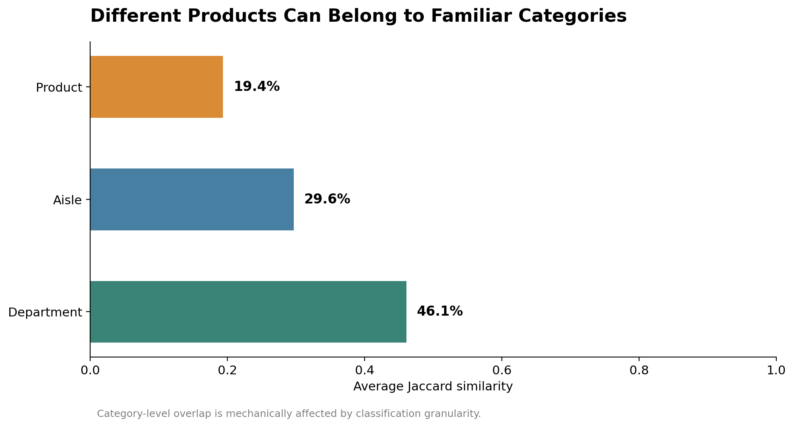
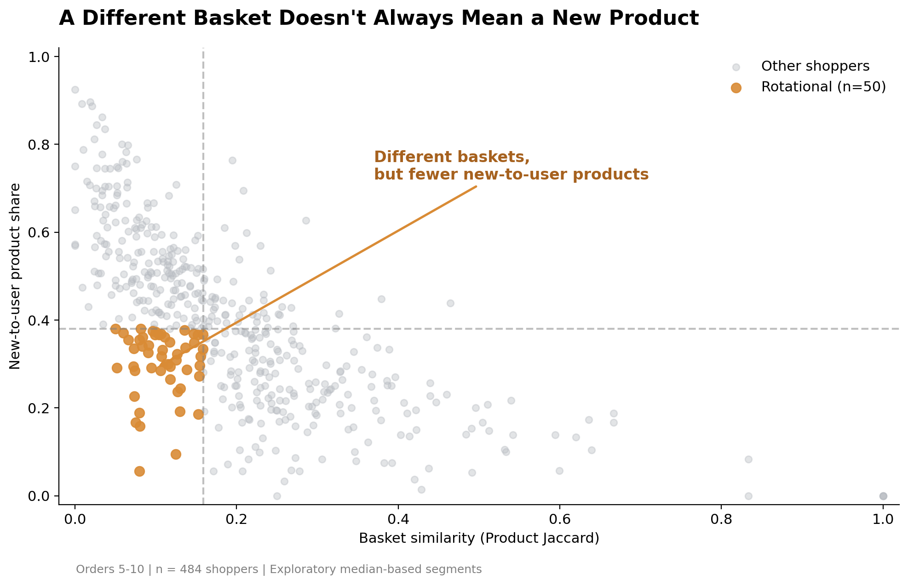
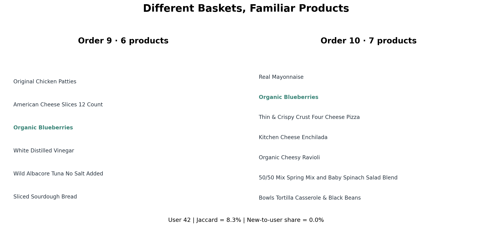
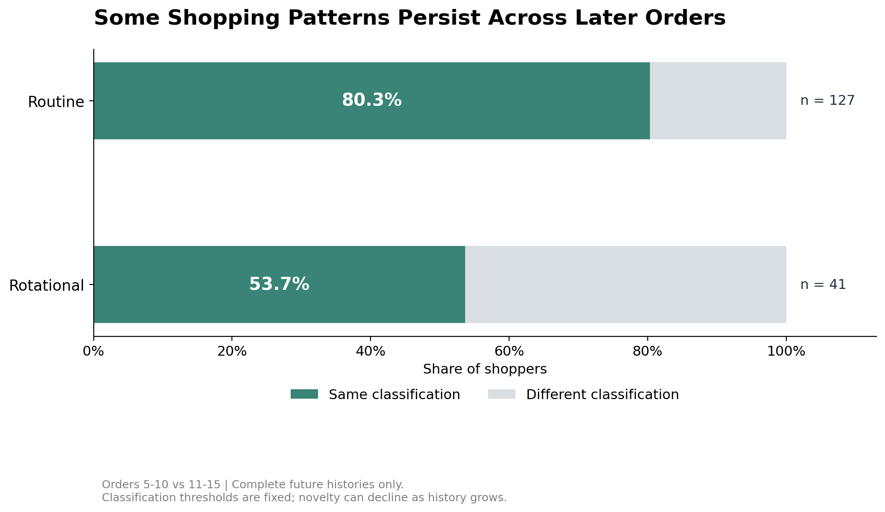

# The Habitual Shopper
### When Shopping Baskets Change, Are Consumers Really Discovering New Products?

**CMU — Telling Stories with Data | Final Project Part I: Proposal**

**Target Audience:** E-commerce Product Managers, Product Analysts, and Recommendation System Teams

**Data Source:** [Instacart Market Basket Analysis — Kaggle](https://www.kaggle.com/competitions/instacart-market-basket-analysis/data)

---

## 1. Project Overview

Online grocery platforms offer consumers thousands of products, yet a changing shopping basket does not necessarily mean that a shopper is discovering something new. A customer might purchase different items on consecutive visits while continuing to rotate among products they have bought before. For e-commerce product managers, this distinction matters: basket variation, repeat purchasing, and product discovery represent different aspects of shopping behavior. Treating them as the same phenomenon may lead to misleading interpretations of how customers use an online marketplace.

This project, **The Habitual Shopper**, investigates how shopping baskets change across repeated purchases using Instacart's publicly available transaction data. The story compares product-level basket similarity, category-level similarity, and the proportion of products previously unseen in a shopper's recorded purchase history. It then explores whether these patterns persist across subsequent orders. Through a four-act narrative, the project aims to demonstrate why basket overlap alone is insufficient to characterize shopping behavior and how a more nuanced understanding could inform future product personalization hypotheses. The analysis is observational and does not evaluate recommendation algorithms or establish improvements in conversion rates.

## 2. Story Outline

### Act 1 — Setup: Shopping Baskets Often Change Between Orders

**Key question:** How similar are a shopper's consecutive grocery orders?

The story begins with a familiar assumption: grocery shopping is repetitive. Consumers regularly need items such as milk, bread, vegetables, and household essentials, so we might expect their shopping baskets to remain fairly consistent. However, measuring the overlap between consecutive orders reveals a more complicated picture.

Using product-level Jaccard similarity, the initial analysis finds an average user-level similarity of approximately **19.4%** among 484 shoppers observed during orders 5–10. The distribution is concentrated toward relatively low values, suggesting that many shoppers do not recreate the same product basket each time they order.

This result creates the story's opening question: **If shopping baskets change so much, does that mean customers are continually discovering new products?**

**Planned visualization:** An annotated histogram of average product-level basket similarity, with the sample mean highlighted and a short explanation of what Jaccard similarity measures.

### Act 2 — Reveal: Different Products Can Belong to Familiar Categories

**Key question:** Does a different product basket necessarily represent a different type of shopping trip?

The second act introduces an important distinction between the specific products purchased and the broader categories they belong to. Two orders can contain different products but still share aisles or departments. For example, choosing different products from the same grocery category changes the product-level basket without necessarily changing its broader composition.

In the fixed-window sample, average basket similarity increases from **19.4% at the product level** to **29.6% at the aisle level** and **46.1% at the department level**. These differences illustrate how the level of product classification affects the apparent consistency of shopping baskets.

The story will explain that broader categories naturally create more opportunities for overlap. Higher category-level similarity therefore should not be interpreted directly as evidence of consumer loyalty or stable preferences.

**Planned visualization:** A horizontal bar chart comparing product-, aisle-, and department-level Jaccard similarity, supported by a simple illustrative basket comparison to explain the distinction.

### Act 3 — Tension: A Different Basket Does Not Always Mean Discovery

**Key question:** Are shoppers purchasing products that are new to their recorded histories, or revisiting familiar products in different combinations?

This act delivers the central insight of the story. Basket similarity compares the products in two consecutive orders, while product novelty considers the shopper's entire previously recorded purchase history. A low similarity score therefore does not necessarily imply a high proportion of new-to-history products.

To make the comparison more consistent, shoppers are evaluated using orders 5–10. Product similarity and novelty are calculated for each shopper, and exploratory median-based thresholds are used to distinguish four descriptive patterns: New-to-user, Rotational, Routine, and Mixed.

Among the **484 eligible shoppers**, **50 (10.3%)** fall into the low-similarity, low-novelty quadrant, labeled *Rotational*. This is an exploratory classification rather than evidence of a naturally occurring customer segment.

A real example makes the distinction tangible. **Shopper 42** purchased six products in order 9 and seven in order 10. Only Organic Blueberries appeared in both orders, producing a Jaccard similarity of **8.3%**. Yet all seven items in order 10 were flagged as previously purchased in the shopper's recorded history, giving that order a **0% new-to-history product share**.

This example demonstrates the central message: **A shopper can substantially change their basket without purchasing products that are new to their recorded history.**

**Planned visualization:** A scatter plot of user-level basket similarity versus novelty, highlighting low-similarity, low-novelty shoppers, followed by a side-by-side comparison of Shopper 42's two real orders.

### Act 4 — Resolution: Some Shopping Patterns Persist Across Later Orders

**Key question:** Are these observed shopping patterns limited to a few orders, or do they continue over time?

The final act examines the extent to which historical behavioral classifications carry forward. The project assigns exploratory segments using orders 5–10, then applies the same classification thresholds to orders 11–15.

Of the 484 fixed-window shoppers, **323 have complete purchase records for the later observation window**. Among this validation subset, **80.3%** of shoppers initially classified as Routine remain in that category, while **53.7%** of those classified as Rotational retain their original classification.

These findings suggest that some descriptive shopping patterns continue across multiple orders, although they are not necessarily permanent. Importantly, product novelty can decline as recorded purchase history accumulates, and shoppers with complete later records differ from those without them. The project will present these limitations alongside the results rather than treating the classifications as fixed customer identities.

The story concludes with an implication for product management: **Recommendation and personalization strategies should not rely on basket overlap alone.** Product managers may benefit from considering purchasing history and category-level behavior when developing hypotheses for future experiments. Whether such approaches improve customer outcomes would require additional behavioral data and controlled testing.

**Planned visualization:** Two simplified 100% stacked horizontal bars comparing the proportion of Routine and Rotational shoppers who retain their original classifications across observation windows.

---

## 3. Initial Visualization Sketches

The following figures are preliminary storytelling sketches based on exploratory analysis. They illustrate the proposed narrative, visual hierarchy, and key messages. They are not final interactive visualizations.

### Sketch 1 — Shopping Baskets Often Change Between Orders

**Purpose:** Introduce the distribution of basket similarity and challenge the expectation that grocery baskets remain nearly identical.

**Key annotation:** Average product-level Jaccard similarity is approximately 19.4% in the fixed-window sample.

**Narrative transition:** If product overlap is relatively low, are consumers exploring unfamiliar products?

### Sketch 2 — Different Products, Familiar Categories

**Purpose:** Show that perceived shopping consistency depends on the level of product classification.

**Key annotation:** Average Jaccard similarity increases from 19.4% for products to 29.6% for aisles and 46.1% for departments.

**Narrative transition:** Even if product categories appear familiar, are the specific products themselves new to the shopper?

### Sketch 3 — A Different Basket Does Not Always Mean a New Product

**Purpose:** Distinguish consecutive-basket variation from purchasing products not previously observed in a shopper's history.

**Visual emphasis:** Shoppers in the low-similarity, low-novelty quadrant are highlighted, while the other observations remain in the background.

**Key annotation:** In the fixed-window exploratory sample, 50 of 484 shoppers fall into the Rotational quadrant.

#### A Real Shopping Example: Shopper 42

Shopper 42's consecutive orders contain substantially different products, but all products in the later order had appeared in the shopper's recorded purchase history. This concrete example explains why basket similarity and novelty should not be treated as interchangeable metrics.

**Narrative transition:** If some shoppers repeatedly rotate among previously purchased products, do these patterns continue in later orders?

### Sketch 4 — Some Shopping Patterns Persist Across Later Orders

**Purpose:** Explore whether descriptive behavioral classifications remain consistent across subsequent purchases.

**Key annotations:** Among users with complete later-order histories, 80.3% of Routine shoppers and 53.7% of Rotational shoppers retain their respective classifications.

**Closing takeaway:** Shopping behavior is more complex than a single repetition metric can capture. Historical patterns may be informative, but they should be interpreted cautiously before informing product decisions.

---

## 4. Data Sources and Analysis Plan

### Data Sources

The primary source is the publicly available [Instacart Market Basket Analysis dataset](https://www.kaggle.com/competitions/instacart-market-basket-analysis/data), released for a 2017 Kaggle competition. The dataset provides anonymized histories of grocery orders, product identifiers, purchase sequence information, and product classifications. This project uses five files: `orders.csv` to identify shoppers and the chronological sequence of their orders; `order_products__prior.csv` to identify products in prior orders and their reordered status; `products.csv` to associate product identifiers with product names; and `aisles.csv` and `departments.csv` to connect products with category information. Joining these sources makes it possible to reconstruct individual shopping baskets and compare successive purchases at multiple levels of detail.

The exploratory analysis begins with the first 1,000 eligible users by user ID rather than a random sample. After requiring complete prior-order records for orders 5–10, the fixed-window sample contains 484 shoppers. A subset of 323 shoppers also has complete records for orders 11–15 and can be used for a later-window comparison. These restrictions improve the consistency of comparisons but limit how broadly the findings can be generalized. Before final publication, the project will clearly identify the sample selection process, distinguish observed results from illustrative examples, and avoid presenting sample percentages as population-wide estimates.

### Analytical Measures

**Product-level Basket Similarity — Jaccard Index**

For two consecutive baskets, A and B:

\[
J(A,B) = \frac{|A \cap B|}{|A \cup B|}
\]

The index measures the proportion of unique products shared by both orders relative to the unique products appearing in either order. A value of zero indicates no shared products; a value of one indicates identical product sets.

**Category-level Basket Similarity**

The same Jaccard calculation is applied separately to sets of product IDs, aisle IDs, and department IDs. These values are not directly interchangeable because the available categories differ substantially in granularity.

**Product Novelty**

Product novelty is defined as the proportion of items in an order with `reordered = 0`, indicating that those products had not previously appeared in the shopper's recorded purchase history. This is a measure of **new-to-recorded-history purchasing**, not the introduction of new products to the marketplace, intentional discovery, or exposure to recommendations.

**Exploratory Behavioral Classification**

Shoppers are grouped using the sample medians of average product-level Jaccard similarity and product novelty during orders 5–10. These four classifications are descriptive analytical constructs rather than validated customer segments. The project also examines shopping basket size, purchasing intervals, and the persistence of classifications in orders 11–15 as sensitivity checks.

### Limitations

This study relies on observational purchase records rather than product impressions, browsing activity, search behavior, or recommendation exposure. It cannot determine why a shopper selected a product or whether a recommendation increased conversion, engagement, or retention. Product novelty is affected by the length of the observed purchasing history, and Jaccard similarity is influenced by basket size. Classification at the aisle and department levels also changes the meaning and expected magnitude of overlap. Additionally, the initial sample is not random, and later-window validation disproportionately includes shoppers with shorter historical purchasing intervals. All conclusions will therefore be presented as exploratory and descriptive, not causal.

---

## 5. Method and Medium

**Data preparation and analysis:** Python, Pandas, and NumPy will be used to clean, join, and organize the order and product data, calculate basket-level and user-level metrics, and perform descriptive robustness checks.

**Visual design:** Initial sketches are produced with Matplotlib. The final graphics are expected to be refined using Tableau and/or Plotly to improve readability, annotation, and reader engagement.

**Storytelling medium:** The intended final presentation is a web-based, scroll-driven narrative using GitHub Pages or a comparable interactive storytelling platform. Readers will move through the four acts sequentially, with focused visual explanations and a real basket example connecting quantitative findings to an intuitive consumer experience. The final medium will be selected based on implementation feasibility and course requirements.

**Intended outcome:** The project will provide an accessible explanation of why different measures of basket change can lead to different interpretations of consumer behavior, together with practical questions that e-commerce product managers could investigate through future experiments.

---

## 6. References

- Instacart. (2017). *Instacart Market Basket Analysis*. Kaggle. https://www.kaggle.com/competitions/instacart-market-basket-analysis/data
- Project visualizations and descriptive analysis are based on the Instacart dataset and were prepared specifically for this course project.
